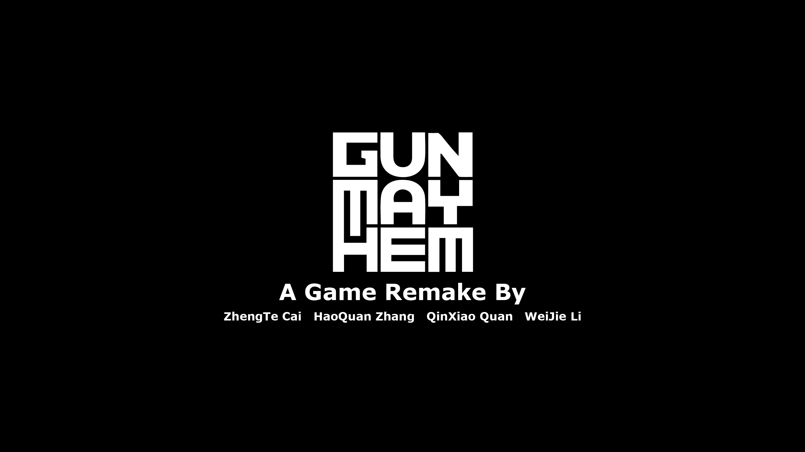

# Gun Mayhem · Cocos2d-x Remake

> 2D 射击 PVP 游戏 **Gun Mayhem** 的 Cocos2d-x 重制版，含 Windows 原生版与 Emscripten / WebAssembly Web 版。
>
> **重要署名**：原版游戏由 **Kevin Gu** 创作；本重制版由 **蔡政特（ZhengTe Cai）、张皓泉（HaoQuan Zhang）、全秦霄（QinXiao Quan）、李伟杰（WeiJie Li）** 完成。  
> 本仓库由 **hhxpoint** 整理、补文档与发布，**不主张原项目/团队代码与素材的原创版权**。



---

## 项目说明

- 游戏类型：2D 横版射击 PVP
- 玩法：移动、跳跃、射击、手雷/闪光弹、武器切换、宝箱掉落、AI 对手、计时/计分/排行榜
- 中文名：枪战王者重制版
- 原始项目页：<https://haoquanzhang.github.io/GunMayhem/gunMayhem.html>
- 原版：<https://gun-mayhem-2.github.io/>

---

## 目录结构

```text
gun-mayhem/
├── native/                 # Cocos2d-x Windows 原生版
│   ├── Classes/            # 游戏逻辑
│   ├── Resources/          # 图片、音效、字体
│   ├── docs/               # Design / Log / Setup
│   ├── CMakeLists.txt
│   └── README.md
├── web/                    # Emscripten Web 版
│   ├── Game/               # Classes / Resources / proj.emscripten / CMakeLists
│   ├── build-emscripten.bat
│   ├── run-web.bat
│   └── README.md
├── docs/cover.png
├── CONTRIBUTORS.md
├── NOTICE
├── README.md
└── LICENSE
```

---

## 运行方式

### Windows 原生版

环境：

- Visual Studio 2019/2022
- Cocos2d-x 4.0（或按 `native/COCOS2DX_3.17.2_MIGRATION.md`）
- CMake

步骤：

1. 安装 Cocos2d-x，配置 `COCOS2DX_ROOT`
2. 用 CMake 生成 VS 工程（`native/CMakeLists.txt`）
3. 编译 `GunMayhem` 目标
4. 运行生成的 exe；资源目录需与 exe 同级/按工程配置

详细步骤见 `native/docs/Setup.md`。

### Web / WebAssembly 版

环境：

- Emscripten SDK
- Cocos2d-x 3.17.2
- CMake 3.6+
- Python（本地静态服务器）

```bash
cd web
# 修改 build-emscripten.bat 内 EMSDK/COCOS2DX 路径
build-emscripten.bat
cd build/emscripten
python -m http.server 8000
# 浏览器打开 http://localhost:8000
```

Linux/macOS 构建步骤见 `web/README.md`。

> 仓库不包含 Cocos2d-x 引擎源码、`build/` 编译产物与 `dist/` 可执行文件；需按文档自行准备。

---

## 操作

| 操作 | 按键 |
|---|---|
| 移动 | A/D 或 ←/→ |
| 跳跃 | W / ↑ / Space |
| 射击 | 鼠标左键 |
| 手雷 | F |
| 闪光弹 | G |
| 切换武器 | Q/E |
| 暂停 | ESC |

（以实际 `Classes/` 输入绑定为准。）

---

## 功能

- 开始界面、背景音乐、音量、暂停/继续、退出
- 创建/加入房间，支持添加 AI
- 手枪、狙击枪、机枪、爆炸包等武器
- 宝箱掉落与武器拾取
- 角色身体组件、技能、武器动画
- 无限生命、计时、暴击/命中显示、计分/排行榜
- 攻击/爆炸特效

---

## 测试与验收

仓库以游戏工程为主，未提供自动化测试；手工验收：

- [ ] Windows 原生工程可编译、启动
- [ ] Web 版可构建并在浏览器加载
- [ ] 开始/暂停/退出
- [ ] 移动/跳跃/射击/手雷
- [ ] 武器切换、宝箱拾取
- [ ] AI 对手/房间
- [ ] 计时、计分、排行榜

---

## 贡献者

详见 [CONTRIBUTORS.md](CONTRIBUTORS.md)：

- 原版游戏：Kevin Gu
- 重制团队：蔡政特、张皓泉、全秦霄、李伟杰（华南理工大学）
- 仓库整理/文档/Web 版整理：hhxpoint

---

## 版权与许可

- 原版 Gun Mayhem：Kevin Gu
- 本重制版代码/美术/音频：原始团队各成员
- 本仓库的整理文档、构建说明：hhxpoint

**本仓库不授予原项目代码/素材的商业使用或再许可权利**；仅用于学习、课程展示与作品归档，详见 [NOTICE](NOTICE) 与 [LICENSE](LICENSE)。如原始作者/团队要求调整署名或下架，请联系处理。
